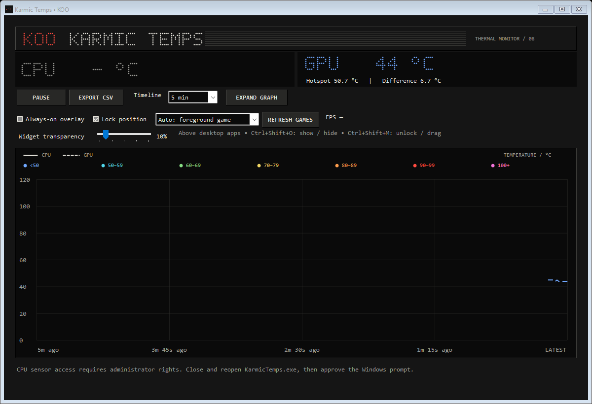
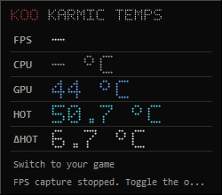

# Karmic Temps

**KOO's Windows temperature monitor with a dot-matrix dashboard and an always-on desktop overlay.**

Nothing OS-inspired typography meets compact, Winamp-inspired controls: CPU and NVIDIA GPU temperatures, GPU hotspot difference, temperature history, and PresentMon-based FPS integration.

**[Download Karmic Temps v8 for Windows](https://github.com/jediluvs2kill/karmic-temps-/releases/download/v8/KarmicTemps-v8.zip)** · [Release notes](https://github.com/jediluvs2kill/karmic-temps-/releases/tag/v8)

Extract the entire ZIP, open the `KarmicTemps-v8` folder, and run `KarmicTemps.exe`. Approve the administrator prompt. If CPU setup is needed, use **Set up CPU** and reopen the app afterward.

The runnable release ZIP includes the application, editable C# source, build/test scripts, and required dependencies. This repository also contains the consolidated **v8 development prompt** and screenshots.

## Screenshots

### Dashboard

### Desktop overlay

These are actual v8 app captures, not mockups. During capture, GPU and hotspot readings were available; CPU sensor access required elevation and FPS capture was inactive. The owner separately confirmed working CPU temperatures after PawnIO setup and working in-game FPS after the v7 fix.

## Features

- Live CPU and NVIDIA GPU temperature readouts.
- **HOT:** GPU hotspot temperature. **ΔHOT:** hotspot minus core temperature, from the same GPU and sampling cycle.
- Up to one hour of temperature history; selectable **30 seconds, 1, 5, 15, 30, or 60 minutes**.
- A large, resizable graph with **CPU solid** and **GPU dashed** lines.
- **Seven shared temperature colors**, from blue below 50°C to pink at 100°C and above; see the scale below. These are visualization bands, not hardware-specific safety limits.
- A compact **250 × 220 pixel** movable, click-through overlay with tighter label/value spacing and rows; it stays above ordinary desktop apps when the dashboard is minimized.
- **Widget transparency from 0–80%**, adjustable live and remembered after normal app closure.
- PresentMon FPS integration with foreground-process detection or manual process selection.
- Pause/resume temperature recording and CSV export, including hotspot and difference.
- Custom vector dot-matrix lettering, dark inset panels, red KOO branding, and compact beveled controls.

## Temperature colors

Both graph series and the CPU/GPU/hotspot widget readings use the same scale. CPU remains solid and GPU dashed. The hotspot difference stays neutral because it is a relative difference.

| Temperature | Color |
| --- | --- |
| Below 50°C | Blue |
| 50°C to below 60°C | Cyan |
| 60°C to below 70°C | Green |
| 70°C to below 80°C | Yellow |
| 80°C to below 90°C | Orange |
| 90°C to below 100°C | Red |
| 100°C and above | Pink |

## Controls

| Control | Action |
| --- | --- |
| `Ctrl+Shift+O` | Show/hide the overlay and start/stop FPS capture |
| `Ctrl+Shift+M` | Unlock/lock the overlay; drag it while unlocked |
| Timeline | Change the visible history window without clearing retained readings |
| Expand graph | Maximize/restore the dashboard |
| Refresh games | Refresh the process selector |
| Widget transparency | 0% opaque to 80% transparent; default 10%; affects the entire widget |
| Export CSV | Save retained temperature history |

Transparency is saved on normal app close in `%LOCALAPPDATA%/KarmicTemps/widget-transparency.txt` and restored on launch.

## Development prompt

Use **[DEVELOPMENT_PROMPT.md](DEVELOPMENT_PROMPT.md)** to reproduce or continue developing the app. It consolidates the latest behavior, visual design, sensor requirements, overlay rules, and validation criteria.

## Runtime requirements

- 64-bit Windows with .NET Framework 4.7.2 or later.
- Administrator access for CPU sensors and Windows frame-event capture.
- **LibreHardwareMonitor 0.9.6** plus **PawnIO 2.2.0** for hardware sensor access.
- **PresentMon 2.6.0** console collector for FPS; NVIDIA's installed `nvidia-smi` is a fallback for GPU core temperature.

The overlay targets desktop, windowed, and borderless applications. Exclusive fullscreen, Windows security prompts, and protected surfaces may cover it. Missing sensor or frame data must appear as unavailable, never as invented readings.

## Project status

The local v8 app has been built and checked for live GPU/hotspot readings, all seven color boundaries, graph transitions and line styles, minimum/default window layouts, transparency persistence, and overlay behavior. FPS regression tests cover the real PresentMon CSV header, changing frame rates, process selection, swap-chain isolation, malformed rows, restart, and stale-data expiry.

The v7 fix corrected a case-sensitive CSV column mismatch: PresentMon emits `msBetweenPresents`, while the old parser expected `MsBetweenPresents`. Matching now ignores casing and surrounding whitespace. The owner confirmed that in-game FPS works after this fix. Karmic Temps does not impose a 120 FPS cap; a simulated 240 FPS stream was also verified.

See [CHANGELOG.md](CHANGELOG.md) for v7 and v8 changes. The runnable package and application source are available together in the [v8 release ZIP](https://github.com/jediluvs2kill/karmic-temps-/releases/tag/v8). GitHub's automatically generated source archives contain the repository documentation; choose **KarmicTemps-v8.zip** to run or build the app.

## Credits

- [LibreHardwareMonitor](https://github.com/LibreHardwareMonitor/LibreHardwareMonitor) — hardware telemetry.
- [PawnIO](https://github.com/namazso/PawnIO.Setup) — CPU sensor driver dependency.
- [Intel PresentMon](https://github.com/GameTechDev/PresentMon) — frame presentation telemetry.

Karmic Temps uses its own KOO branding and vector lettering. It is not affiliated with Nothing or Winamp.
